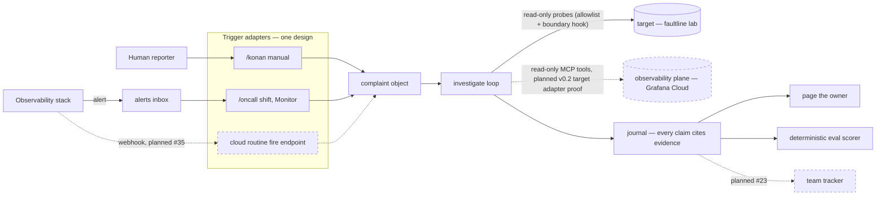
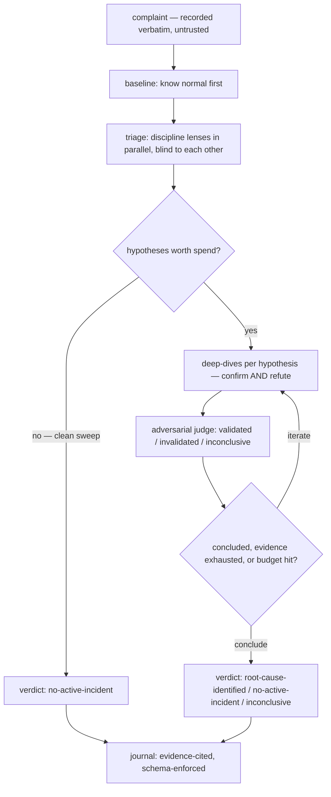

# Architecture & flows

Three pictures of konan, kept current with the code (a PR that changes structure or
flow updates the affected diagram — the docs gate covers diagrams). Solid = shipped;
dashed = planned, labeled with its tracker reference. Contracts behind the pictures:
[product.md](product.md), [triggers.md](triggers.md), [lab.md](lab.md).

## The system

Detection lives outside. One adapter design normalizes every delivery into the same
complaint object; the loop never knows which adapter fired. The investigator touches
the target read-only, through a mechanical allowlist and a content-based boundary
hook (`hooks/boundary.py`) — a security boundary is never a prompt. The eval spine is
blinded from investigations by contract.



## The investigation loop

Baseline before judgment; blind parallel first looks; every hypothesis must predict
observable state; a judge whose job is to refute. "No incident" is a legitimate,
evidence-requiring verdict.



## The on-call trigger path

The inbox line is durable: an alert raised while nobody watches waits, and the
latency stamp shows the wait honestly. Between events the shift is idle at zero
model cost — delivery is push or event, never poll.

```mermaid
sequenceDiagram
  participant A as Alerter (stack / eval-side)
  participant I as alerts/inbox.jsonl
  participant S as /oncall shift session
  participant T as target telemetry
  participant O as shift owner

  A->>I: append complaint line (fingerprint, startsAt)
  Note over S: shift start — catch-up: any line no journal cites
  S->>I: Monitor tail — event-driven
  I-->>S: new line delivered
  S->>T: probes, logs, metrics — read-only
  S->>S: investigate: lenses, deep-dives, judge
  S->>S: journal written, committed locally
  S->>O: page — one-line verdict
  Note over I,S: machine asleep? the line waits; latency stamped
```
